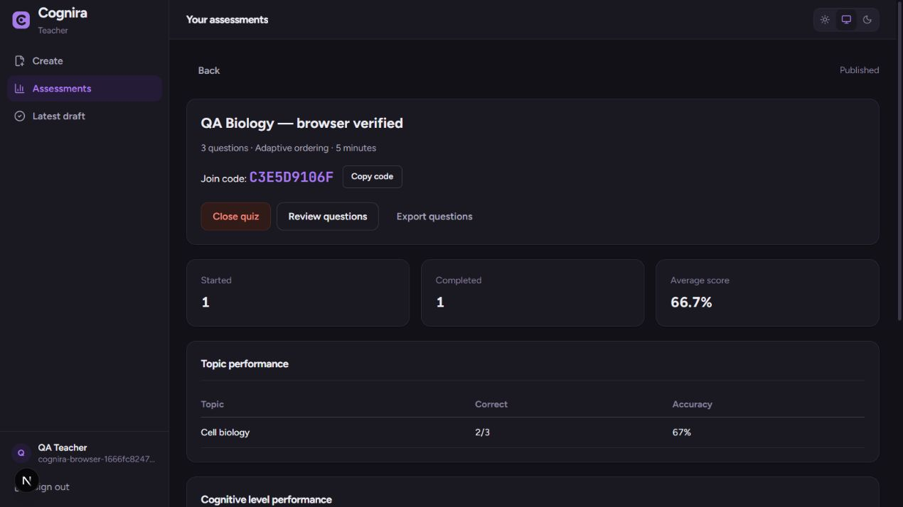
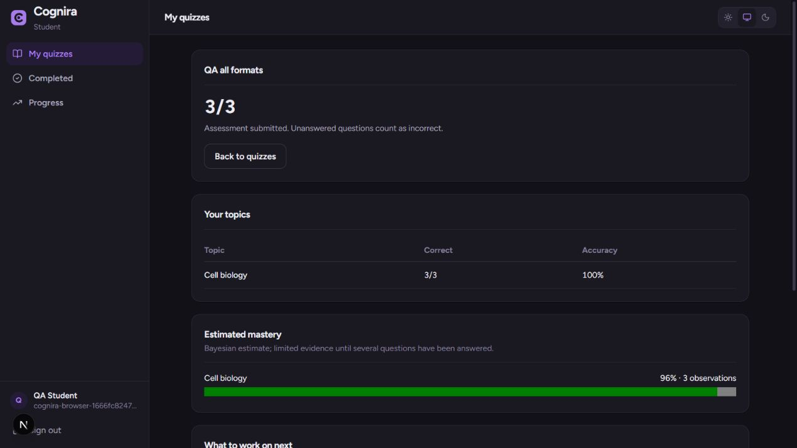
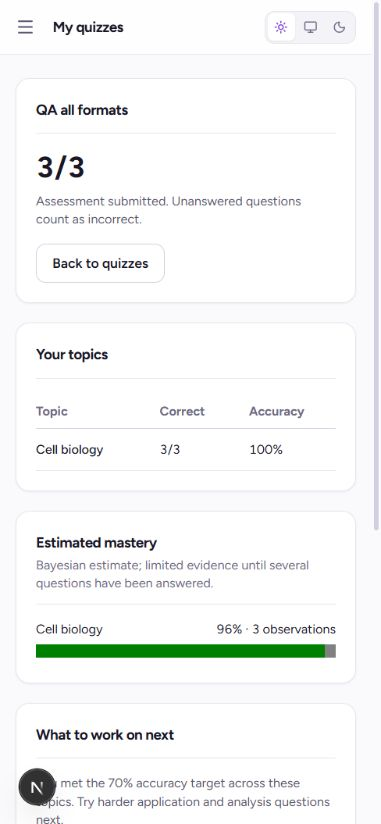

# End-to-end verification: 26–27 October 2026

The checks below ran against the local application and its configured Supabase
and Google Gemini services. Temporary accounts and sample course material were
used throughout application tests.

## Automated checks

- 43 backend regression tests cover ingestion, cleaning, stable identifiers,
  embeddings, retrieval, evidence validation, independent review, scoring,
  adaptation, knowledge tracing, expiry, concurrency and authorization.
- 17 frontend regressions cover request deadlines, onboarding, clock skew and
  countdown continuity, upload limits, empty files and environment configuration.
- TypeScript, ESLint and the production Next.js build passed for this patch.
- `pip check` found no broken requirements. Direct backend dependencies are
  pinned to the installed versions used for these checks.

Run backend tests from `backend` with
`.venv/Scripts/python.exe -m unittest discover -p 'test_*.py'`.
Run `npm test`, `npx tsc --noEmit`, `npx eslint` and `npm run build` from
`frontend`. GitHub Actions repeats these checks on push.

## Live service and browser coverage

| Area | Executed checks | Result |
| --- | --- | --- |
| Account setup | Teacher and student onboarding through the browser; role persistence; reload; existing-role retry | Passed |
| OAuth entry | Google account chooser opens with the configured Supabase callback | Passed up to account selection |
| Callback failures/CORS | Missing/invalid OAuth codes and cancellation; invalid token; allowed and rejected browser origins | Passed |
| Ingestion | Real PDF, DOCX, PPTX, native DOC, native PPT and PNG fixtures; image OCR; owned uploads and indexing | All six sources processed successfully |
| Generation | Real embeddings/retrieval, exact evidence, semantic/Bloom review and persisted drafts | Passed |
| Teacher authoring | Pasted text, edited draft save, publication, locked questions, join code, closure and saved library | Passed |
| Upload UI | Valid PDF upload and deletion; empty/unsupported file rejection; invalid question count/time | Passed |
| Student attempt | Enrollment, adaptive sequence, autosave, full-page reload/resume, early-submit warning/cancel | Passed |
| All answer formats | Single-answer, multi-select and true/false in the browser | Correct mixed-format responses scored 3/3 |
| Incorrect response | Two correct responses and one deliberate mistake | Scored 2/3; explanations, topic gaps and review sources appeared |
| Progress/analytics | Student progress; teacher averages, topic/Bloom breakdown and student roster | Matched recorded results |
| Exports | Browser downloads of assessment JSON and results CSV, with file-content checks | Matched the title, questions and 2/3 score |
| Admin | Test-account role change/restore, suspension/restore, audit events and rejected self-demotion | Passed |
| Security | Missing/wrong-role token, ownership isolation, enrollment checks, stale answers, expired attempts, profile escalation, private storage and answer-key protection | Passed live API checks |
| Failure recovery | Local API stopped; frontend showed a clear error; retry after restart cleared the error and loaded assessments | Passed |
| Keyboard/mobile | Dialog focus and Escape; mobile drawer; teacher/student layouts at 390×844; light/system themes | Passed; no document-width overflow |

## Bugs corrected during this pass

1. Reopening the quiz view reset its displayed timer. The reproduced change was
   4:44 to 5:00. Clock offsets are now captured when a server response arrives;
   switching views preserves the countdown. Server deadlines remain authoritative.
2. Login, account loading, sign-out and API calls could wait indefinitely.
   Session and request deadlines now provide errors and allow retries. Storage
   uploads and AI operations receive longer budgets than ordinary requests.
3. The sign-in dialogs left keyboard focus behind the overlay. They now use a
   native modal dialog with focus trapping and Escape support.
4. An eleventh upload and empty files could reach storage/request validation.
   Client validation now matches the API's count and byte limits.
5. A custom question count of zero silently became ten, and zero minutes could
   pass readiness checks. Both now display the appropriate validation message.
6. An old library error remained visible after a successful refresh. Successful
   retries now clear it.
7. Empty legacy public-key settings masked a valid publishable key. Environment
   values are trimmed and blank legacy keys fall back correctly.
8. Authentication transport/provider outages looked like expired sessions.
   The API now returns a retryable 503 for those failures and retains 401 for
   invalid credentials.
9. The privacy text omitted AI processing, and Support showed an unverified
   mailbox/hours. The copy now describes the implemented data flow and directs
   users to their instructor or administrator.

## Test evidence

## Scope still requiring user access

- Completing OAuth with the personal Google account was blocked by automatic
  approval review because it could create or update a real Cognira profile.
  Account selection was not performed. Explicit approval was requested.
  Application session/onboarding tests used isolated Supabase accounts instead.
- The deployed website URL was requested but was not supplied during this pass.
  A successful hosting build is not treated as deployed-runtime verification.
- These are functional checks with representative fixtures, not a load test,
  a calibration study of mastery/Bloom estimates, or proof of every possible
  document layout and provider failure.

The temporary session helper, its credentials, the three browser test accounts,
two test assessments, stored fixtures and related database rows were removed.
Real accounts, material and unrelated editor settings were preserved.
